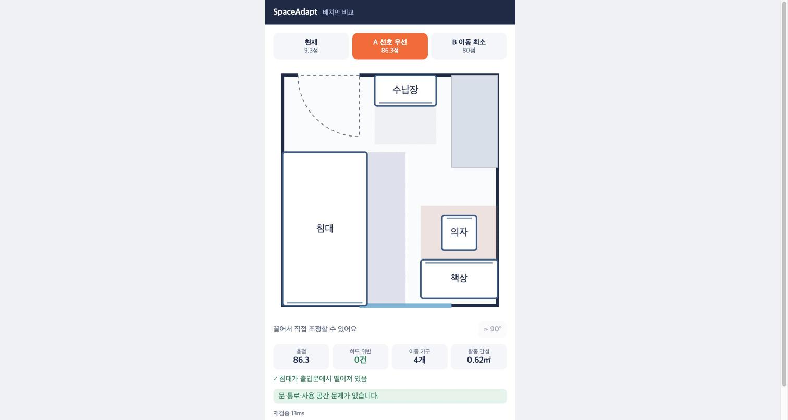

# SpaceAdapt

방 사진 속 생활 흔적을 읽고, 실제 치수로 검증된 가구 배치를 제안하는 청년 1인 가구 AI 공간 플래너.
2026 대한민국 청년 CAREER FAIR AI 해커톤 · 팀 Rooming

- 프로젝트 소개서: [docs/SpaceAdapt_프로젝트소개서.html](docs/SpaceAdapt_프로젝트소개서.html)
- 요구사항 정의서: [docs/요구사항정의서.md](docs/요구사항정의서.md) · 구현 계획: [docs/구현계획.md](docs/구현계획.md)



## 흐름

방 사진 선택 → 로컬 VLM이 가구·생활 단서 추출 → 확인 질문(최대 3개) → 배치안 2개(선호 우선 / 이동 최소) 비교 → 터치 수정·즉시 재검증 → 가구 이동 순서 가이드

## 구성

| 경로 | 내용 |
| --- | --- |
| `backend/spaceadapt/` | FastAPI 앱, Shapely 기하 검증(`validate.py`), 휴리스틱 배치 생성(`planner.py`), 로컬 VLM(`vlm.py`), 확인 질문(`questions.py`), 이동 가이드(`guide.py`) |
| `frontend/` | Vue 3 + Konva 모바일 웹 (2D 편집기, 배치안 비교) |
| `data/rooms/`, `data/images/` | 합성 방 3종 (JSON 정답 + FLUX.1-schnell 생성 사진) |
| `data/measurements.json` | 검증 측정 결과 (`backend/scripts/measure.py`) |

## 실행

요구: Python 3.12, [uv](https://docs.astral.sh/uv/), Node.js 20+.
실제 VLM은 Apple Silicon Mac에서만 동작한다. 다른 환경에서는 `SPACEADAPT_VLM=mock`으로 정답 단서 목 데이터를 사용한다.

```bash
# 백엔드 (포트 8010)
cd backend
uv sync
SPACEADAPT_VLM=mock uv run uvicorn spaceadapt.api:app --port 8010   # Apple Silicon이면 SPACEADAPT_VLM=mock 생략

# 프론트엔드 (다른 터미널)
cd frontend
npm install
npm run dev   # http://localhost:5173
```

첫 VLM 호출 때 `mlx-community/Qwen3-VL-8B-Instruct-4bit`(약 5~6GB)를 내려받는다.

## 테스트 · 측정

```bash
cd backend
SPACEADAPT_VLM=mock uv run pytest -q
uv run python scripts/measure.py          # VLM 포함 측정, data/measurements.json 갱신
```

| 항목 | 결과 (합성 방 3종) |
| --- | --- |
| 하드 위반 | 기준 배치 2~3건 → 배치안 0건 |
| 재검증 p95 | 최대 0.9ms |
| VLM 가구 재현율 / 단서 재현율 | 85% / 67% |
| 질문 3개로 확정되는 항목 | 단서 없음 3개 → 단서 사용 5개 |
